# Práctica CIS Benchmark: Hardening de Router, Switch y FortiGate

**Omar Paulino - Matrícula 20251325**

## Video de demostración

[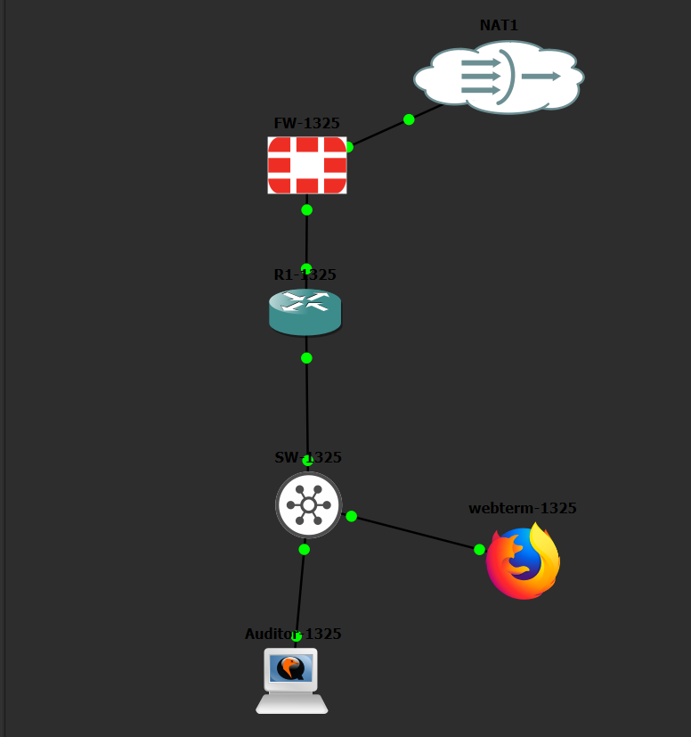](ENLACE_DEL_VIDEO)

**Enlace al video:** ENLACE_DEL_VIDEO

---

## Contenido

1. [Propósito del laboratorio](#1-propósito-del-laboratorio)
2. [Topología](#2-topología)
3. [Direccionamiento IP](#3-direccionamiento-ip)
4. [Equipos, credenciales y herramientas](#4-equipos-credenciales-y-herramientas)
5. [Configuración base](#5-configuración-base)
6. [Análisis con herramientas CIS](#6-análisis-con-herramientas-cis)
7. [Recomendaciones elegidas](#7-recomendaciones-elegidas)
8. [Script de hardening](#8-script-de-hardening)
9. [Hardening manual](#9-hardening-manual)
10. [Pruebas de las recomendaciones](#10-pruebas-de-las-recomendaciones)
11. [Script en modo aplicar y análisis posterior](#11-script-en-modo-aplicar-y-análisis-posterior)
12. [Running-configs, scripts e informes](#12-running-configs-scripts-e-informes)

---

## 1. Propósito del laboratorio

El objetivo de esta práctica es endurecer (hardening) una red con un router, un switch y un firewall FortiGate siguiendo las recomendaciones del **CIS Benchmark**. Primero monté los equipos con una configuración que funciona pero que es insegura a propósito. Después los analicé con herramientas basadas en CIS, elegí 9 recomendaciones, las apliqué, expliqué por qué y las probé. Por último, escribí un script en Python que revisa esas mismas reglas en los tres equipos y que tiene dos modos: uno que solo genera un informe sin cambiar nada, y otro que aplica las reglas que fallan y genera un informe posterior.

### Requisitos y cómo los cumplí

| Requisito | Cómo lo cumplí |
|---|---|
| Red con router, switch y firewall | R1-1325 (Cisco 7206VXR), SW-1325 (Cisco IOSvL2) y FG-1325 (FortiGate 7.0.9) en GNS3 |
| Analizar los equipos con una herramienta basada en CIS | **ONYX** para el router y el switch (CIS Cisco IOS 15 Benchmark) y **FortiGate CIS Checker** para el firewall (CIS FortiGate 7.0.x Benchmark) |
| Aplicar algunas recomendaciones | 6 recomendaciones en R1-1325 y 3 en FG-1325, aplicadas a mano |
| Documentar por qué se aplicaron | Tabla de la [sección 7](#7-recomendaciones-elegidas) |
| Probar las recomendaciones | Una prueba por regla en la [sección 10](#10-pruebas-de-las-recomendaciones) |
| Script que revise las reglas, en modo informe sin aplicar | `python3 cis_hardening.py --audit` |
| Script que aplique las reglas y genere un informe posterior | `python3 cis_hardening.py --apply`. Corrigió el switch, que no toqué a mano |

---

## 2. Topología

### Topología en GNS3


| Nodo en GNS3 | Hostname | Plantilla |
|---|---|---|
| NAT1 | NAT1 | Nodo NAT de GNS3 |
| FW-1325 | FG-1325 | FortiGate 7.0.9 (FortiGate-VM64-KVM) |
| R1-1325 | R1-1325 | Cisco c7200 |
| SW-1325 | SW-1325 | Cisco IOSvL2 |
| Auditor-1325 | auditor-1325 | Ubuntu Cloud Guest 24.04 LTS |
| webterm-1325 | webterm-1325 | webterm (contenedor con Firefox) |

### Diagrama lógico

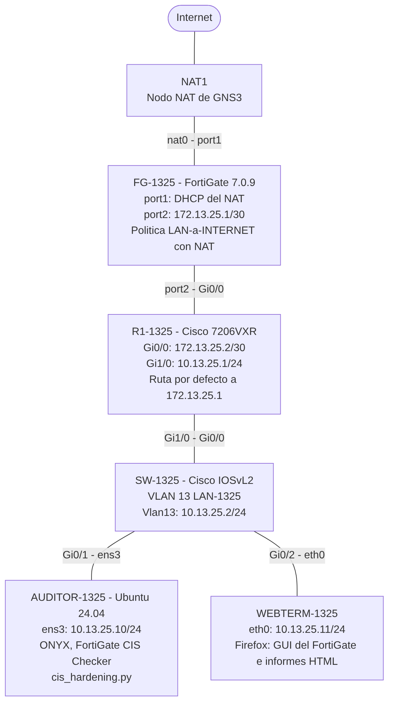

El FortiGate es la salida a internet de toda la red: recibe su IP del nodo NAT por port1 y hace NAT de la red interna. El router conecta el FortiGate con la LAN `10.13.25.0/24`, donde están el switch, el Ubuntu auditor y el webterm.

- **AUDITOR-1325** es la estación desde la que se audita: tiene las herramientas CIS y el script, y entra por SSH al router, al switch y al FortiGate.
- **WEBTERM-1325** es el navegador desde el que configuré el FortiGate por GUI y desde el que abro los informes HTML de las herramientas.

### Proceso de la práctica

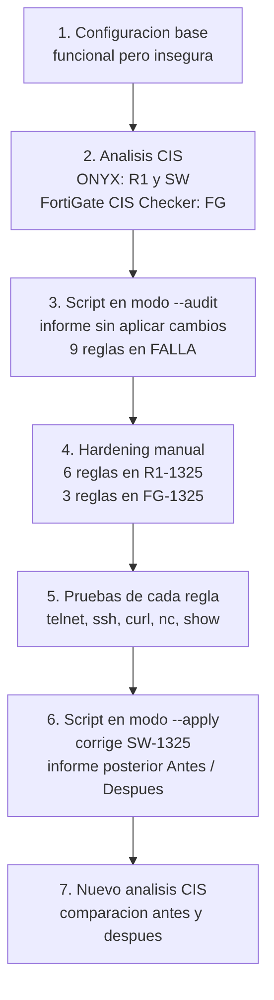

---

## 3. Direccionamiento IP

El direccionamiento se basa en mi matrícula 2025**1325**: la LAN es `10.13.25.0/24`, el enlace entre el FortiGate y el router es `172.13.25.0/30` y la VLAN es la **13**.

| Equipo | Interfaz | Dirección IP | Gateway | Cómo la obtiene |
|---|---|---|---|---|
| FG-1325 | port1 (WAN) | IP del nodo NAT | El del nodo NAT | DHCP del nodo NAT |
| FG-1325 | port2 (hacia R1) | 172.13.25.1/30 | No aplica | Fija |
| R1-1325 | Gi0/0 (hacia FG) | 172.13.25.2/30 | 172.13.25.1 (ruta por defecto) | Fija |
| R1-1325 | Gi1/0 (LAN) | 10.13.25.1/24 | No aplica | Fija |
| SW-1325 | Vlan13 | 10.13.25.2/24 | 10.13.25.1 | Fija |
| AUDITOR-1325 | ens3 | 10.13.25.10/24 | 10.13.25.1 | Fija (netplan) |
| WEBTERM-1325 | eth0 | 10.13.25.11/24 | 10.13.25.1 | Fija |

### Rutas

| Equipo | Ruta | Siguiente salto |
|---|---|---|
| FG-1325 | 10.13.25.0/24 (LAN) | 172.13.25.2 por port2 |
| FG-1325 | Por defecto | La recibe del nodo NAT por DHCP |
| R1-1325 | 0.0.0.0/0 | 172.13.25.1 (FG-1325) |
| SW-1325 | 0.0.0.0/0 y `ip default-gateway` | 10.13.25.1 (R1-1325) |

### Cableado

| Origen | Puerto | Destino | Puerto |
|---|---|---|---|
| NAT1 | nat0 | FG-1325 | port1 |
| FG-1325 | port2 | R1-1325 | Gi0/0 |
| R1-1325 | Gi1/0 | SW-1325 | Gi0/0 |
| SW-1325 | Gi0/1 | AUDITOR-1325 | ens3 (Ethernet0 en GNS3) |
| SW-1325 | Gi0/2 | WEBTERM-1325 | eth0 |

### VLAN del switch

| VLAN | Nombre | Puertos |
|---|---|---|
| 13 | LAN-1325 | Gi0/0, Gi0/1, Gi0/2 |

---

## 4. Equipos, credenciales y herramientas

### Equipos

| Equipo | Plataforma | Software |
|---|---|---|
| FG-1325 | FortiGate-VM64-KVM | FortiOS 7.0.9 build 0444 |
| R1-1325 | Cisco 7206VXR (Dynamips) | IOS 15.2 |
| SW-1325 | Cisco IOSvL2 (QEMU) | vios_l2 15.2 |
| AUDITOR-1325 | Ubuntu Cloud Guest (QEMU), 2048 MB de RAM | Ubuntu 24.04 LTS, Python 3.12 |
| WEBTERM-1325 | Contenedor Docker | Debian con Firefox |

### Credenciales

| Equipo | Usuario | Contraseña |
|---|---|---|
| R1-1325 y SW-1325 | `admin1325` (privilegio 15) | `Admin#1325`, enable secret `Enable#1325` |
| FG-1325 | `admin` | `Forti1325!` |
| AUDITOR-1325 | `ubuntu` | `ubuntu` |

### Herramientas y por qué las usé

| Herramienta | Para qué la usé | Por qué |
|---|---|---|
| **GNS3 + VMware** | Montar la red | Emula equipos Cisco y Fortinet reales |
| **Ubuntu (AUDITOR-1325)** | Estación de auditoría | Las herramientas CIS y el script son de Python y trabajan por SSH, así que todo se hace desde un solo equipo de la LAN |
| **[ONYX](https://github.com/UncleSocks/onyx-caaat-automated-cisco-configuration-assessment-and-auditing-tool)** | Analizar R1-1325 y SW-1325 | Se conecta por SSH y revisa automáticamente la configuración contra el **CIS Cisco IOS 15 Benchmark**. Genera un informe HTML con los controles que pasan y los que fallan, separados en Management, Control y Data Plane |
| **[FortiGate CIS Checker](https://github.com/Coldfirex/Fortigate_CIS_check)** | Analizar FG-1325 | Revisa un archivo de configuración del FortiGate contra el **CIS FortiGate 7.0.x Benchmark** y genera un informe HTML y CSV |
| **Python + Netmiko** | El script `cis_hardening.py` | Netmiko maneja por SSH tanto equipos Cisco (`cisco_ios`) como Fortinet (`fortinet`): lee la configuración y envía comandos |
| **Paramiko 3** | Librería SSH que usan Netmiko y ONYX | Las versiones 4 y superiores ya no aceptan el intercambio de claves con sha1, que es el que ofrece el IOS 15 |
| **Webterm** | Configurar el FortiGate por GUI y ver los informes HTML | El Ubuntu no tiene navegador. Los informes los publico con `python3 -m http.server 8000` y los abro en `http://10.13.25.10:8000` |

---

## 5. Configuración base

La configuración base es **funcional pero insegura a propósito**: Telnet y HTTP habilitados, sesiones sin límite de tiempo, sin banners, contraseñas en texto claro y SSH en versión 1.99. Así el análisis CIS encuentra fallas que después se corrigen.

### 5.1 FortiGate FG-1325 (por GUI)

Lo único que hice por consola fue poner la IP de port2 para poder abrir la GUI desde la LAN ([`FG-1325_consola_inicial.txt`](CIS-HARDENING/scripts/fortigate/FG-1325_consola_inicial.txt)):

```
config system interface
    edit "port2"
        set ip 172.13.25.1 255.255.255.252
        set allowaccess ping https
    next
end
```

El resto lo configuré desde el Firefox del webterm en `https://172.13.25.1` ([`FG-1325_base_gui.md`](CIS-HARDENING/scripts/fortigate/FG-1325_base_gui.md)):

| Qué | Dónde en la GUI | Valores |
|---|---|---|
| Hostname y timeout | System → Settings | Hostname `FG-1325`. Idle timeout: 480 minutos |
| port1 (WAN) | Network → Interfaces → port1 | Addressing mode: DHCP. Administrative Access: HTTPS, HTTP, PING, SSH |
| port2 (hacia R1) | Network → Interfaces → port2 | Alias `HACIA-R1-1325`. Role: LAN. IP `172.13.25.1/30`. Administrative Access: HTTPS, HTTP, PING, SSH, TELNET |
| Ruta a la LAN | Network → Static Routes | Destino `10.13.25.0/24`, gateway `172.13.25.2`, interfaz port2 |
| Política de salida | Policy & Objects → Firewall Policy | `LAN-a-INTERNET`: de port2 a port1, todo permitido, con NAT |

En la política también configuré `tcp-mss-sender` y `tcp-mss-receiver` en 1360 para ajustar el tamaño de los segmentos TCP que salen a internet a través de los dos NAT.

### 5.2 Router R1-1325

[`R1-1325_base.txt`](CIS-HARDENING/scripts/router/R1-1325_base.txt)

```
hostname R1-1325
no ip domain-lookup
ip domain-name omar1325.local
enable secret Enable#1325
username admin1325 privilege 15 secret Admin#1325
interface GigabitEthernet0/0
 ip address 172.13.25.2 255.255.255.252
 ip tcp adjust-mss 1360
 no shutdown
interface GigabitEthernet1/0
 ip address 10.13.25.1 255.255.255.0
 ip tcp adjust-mss 1360
 no shutdown
exit
ip route 0.0.0.0 0.0.0.0 172.13.25.1
ip http server
crypto key generate rsa modulus 2048
line con 0
 password Consola1325
 exec-timeout 0 0
 login local
line vty 0 4
 exec-timeout 0 0
 login local
 transport input telnet ssh
```

| Configuración | Por qué es insegura |
|---|---|
| `transport input telnet ssh` | Permite Telnet, que envía las credenciales en texto claro |
| `exec-timeout 0 0` | Las sesiones nunca se cierran solas |
| `ip http server` | Servidor web de administración activo sin necesidad |
| `password Consola1325` sin `service password-encryption` | La contraseña se ve en texto claro en la configuración |
| Sin `ip ssh version 2` | El IOS queda en SSH 1.99, que también acepta SSHv1 |
| Sin banner | No hay aviso de acceso restringido |

### 5.3 Switch SW-1325

[`SW-1325_base.txt`](CIS-HARDENING/scripts/switch/SW-1325_base.txt)

```
hostname SW-1325
no ip domain-lookup
ip domain-name omar1325.local
enable secret Enable#1325
username admin1325 privilege 15 secret Admin#1325
vlan 13
 name LAN-1325
exit
interface range GigabitEthernet0/0 - 2
 switchport mode access
 switchport access vlan 13
 no shutdown
exit
interface Vlan13
 ip address 10.13.25.2 255.255.255.0
 no shutdown
exit
ip default-gateway 10.13.25.1
ip route 0.0.0.0 0.0.0.0 10.13.25.1
ip http server
crypto key generate rsa modulus 2048
line con 0
 password Consola1325
 exec-timeout 0 0
 login local
line vty 0 15
 exec-timeout 0 0
 login local
 transport input telnet ssh
```

Tiene las mismas debilidades que el router. El switch no lo endurecí a mano: lo corrigió el script.

### 5.4 Ubuntu AUDITOR-1325

Para instalar las herramientas conecté el Ubuntu un momento a un nodo NAT de GNS3 con DHCP ([`01_instalar_herramientas.sh`](CIS-HARDENING/scripts/auditor/01_instalar_herramientas.sh)):

```
sudo apt install -y python3-venv git telnet curl
mkdir -p ~/cis-1325 && cd ~/cis-1325
python3 -m venv venv
source venv/bin/activate
pip install netmiko tqdm
git clone https://github.com/UncleSocks/onyx-caaat-automated-cisco-configuration-assessment-and-auditing-tool.git onyx
pip install -r onyx/requirements.txt
git clone https://github.com/Coldfirex/Fortigate_CIS_check.git fgcheck
pip install "paramiko<4"
```

Después le puse la IP fija de la LAN y lo conecté a SW-1325 Gi0/1 ([`02_red_laboratorio.sh`](CIS-HARDENING/scripts/auditor/02_red_laboratorio.sh), [`netplan_auditor-1325.yaml`](CIS-HARDENING/running-configs/netplan_auditor-1325.yaml)):

```yaml
network:
  version: 2
  ethernets:
    ens3:
      addresses: [10.13.25.10/24]
      routes:
        - to: default
          via: 10.13.25.1
      nameservers:
        addresses: [8.8.8.8]
```

Para entrar por SSH desde la consola a los equipos IOS 15, en `~/.ssh/config` activé los algoritmos antiguos que ofrecen (`diffie-hellman-group14-sha1`, `ssh-rsa` y cifrado `aes-cbc`) solo para la red `10.13.25.*`.

### 5.5 Webterm

IP fija configurada en GNS3 (clic derecho → **Edit config**) ([`network-config.txt`](CIS-HARDENING/scripts/webterm/network-config.txt)):

```
auto eth0
iface eth0 inet static
    address 10.13.25.11
    netmask 255.255.255.0
    gateway 10.13.25.1
```

---

## 6. Análisis con herramientas CIS

Script con los comandos: [`04_analisis_cis.sh`](CIS-HARDENING/scripts/auditor/04_analisis_cis.sh)

### 6.1 Router y switch con ONYX

```
source ~/cis-1325/venv/bin/activate
cd ~/cis-1325/onyx/src/onyx_unclesocks
python3 onyx.py -i -v 15 -o R1-1325.html
python3 onyx.py -i -v 15 -o SW-1325.html
```

| Opción | Para qué |
|---|---|
| `-i` | Modo interactivo: pide la IP, el usuario, la contraseña y el enable del equipo |
| `-v 15` | Usa el CIS Cisco IOS 15 Benchmark |
| `-o` | Nombre del informe HTML, que se guarda en `report_modules/reports/` |

**R1-1325 antes del hardening:** 13 controles cumplen y 43 fallan, de 56. En el Management Plane, que es donde están las reglas de acceso administrativo, solo pasan 4 y fallan 17.

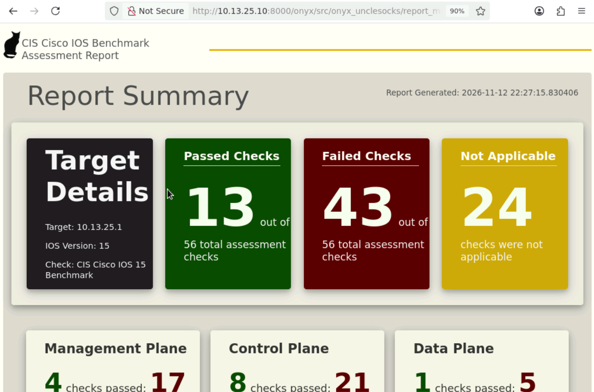

**SW-1325 antes del hardening:** 15 cumplen y 41 fallan.

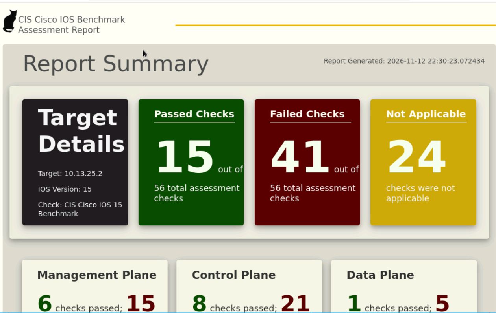

Los 24 controles *Not Applicable* son de protocolos que no uso en la red, como OSPF, RIP o BGP.

### 6.2 FortiGate con FortiGate CIS Checker

Esta herramienta analiza un archivo de configuración, así que primero descargué la configuración del FortiGate por SSH con [`03_exportar_config_fortigate.py`](CIS-HARDENING/scripts/auditor/03_exportar_config_fortigate.py) y después la analicé:

```
cd ~/cis-1325
python3 03_exportar_config_fortigate.py
cd ~/cis-1325/fgcheck/Python
python3 fortigate_cis_checker.py ~/cis-1325/fg_config
```

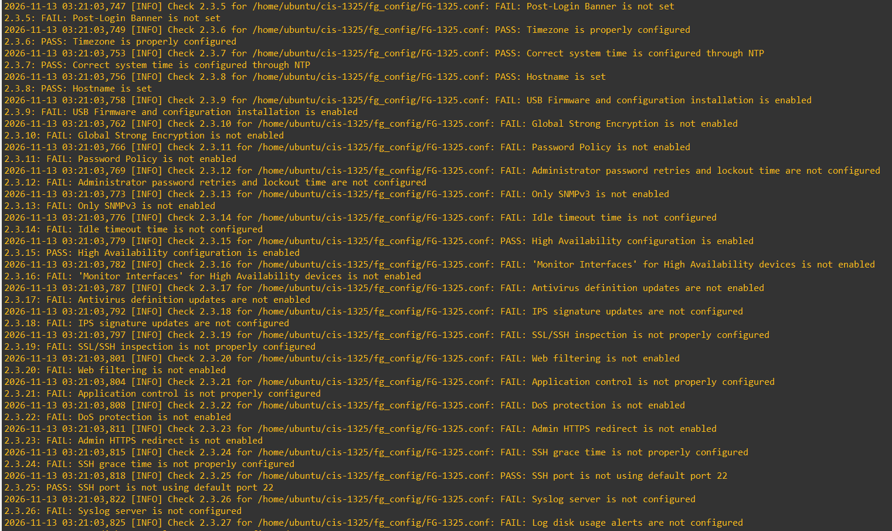

**FG-1325 antes del hardening:** 13 controles cumplen y 38 fallan, de 51. El informe HTML muestra cada control con su resultado, dónde se corrige en la GUI y un ejemplo de comando.

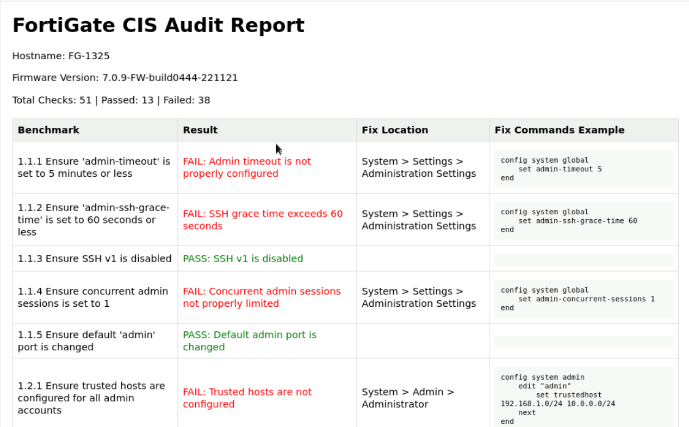

---

## 7. Recomendaciones elegidas

Las herramientas encontraron muchas fallas. De ellas elegí 9, las que más afectan al **acceso administrativo** de los equipos: cómo se entra, si las credenciales viajan cifradas, cuánto tiempo queda abierta una sesión y si se avisa que el acceso es restringido.

| Regla | Equipo | Recomendación CIS | Por qué la apliqué |
|---|---|---|---|
| C01 | Cisco | Solo SSH en las VTY (`transport input ssh`) | Telnet envía el usuario y la contraseña en texto claro; cualquiera que capture el tráfico los ve |
| C02 | Cisco | `exec-timeout` de 5 minutos en consola y VTY | Con `0 0` una sesión olvidada queda abierta para siempre y la puede usar cualquiera |
| C03 | Cisco | Banner de aviso (`banner motd`) | Avisa que el acceso es solo para personal autorizado; tiene valor legal |
| C04 | Cisco | `service password-encryption` | Las contraseñas tipo `password` dejan de verse en texto claro en la configuración |
| C05 | Cisco | `no ip http server` y `no ip http secure-server` | El servidor web de administración no se usa y tiene vulnerabilidades conocidas |
| C06 | Cisco | `ip ssh version 2` | La versión 1.99 también acepta SSHv1, que tiene vulnerabilidades conocidas |
| F01 | FortiGate | Quitar HTTP y Telnet de la administración de las interfaces | Administrar sin cifrado expone las credenciales. Se deja solo HTTPS y SSH |
| F02 | FortiGate | `admintimeout 5` | La base tenía 480 minutos: una sesión de administración abierta todo un día |
| F03 | FortiGate | `pre-login-banner enable` | Aviso legal antes de pedir la contraseña |

C01 a C06 vienen del **CIS Cisco IOS 15 Benchmark** y F01 a F03 del **CIS FortiGate 7.0.x Benchmark**.

| Equipo | Cómo se aplicaron |
|---|---|
| R1-1325 | A mano, las 6 reglas de Cisco ([sección 9.1](#91-router-r1-1325)) |
| FG-1325 | A mano, las 3 reglas del FortiGate ([sección 9.2](#92-fortigate-fg-1325)) |
| SW-1325 | Con el script en modo `--apply` ([sección 11](#11-script-en-modo-aplicar-y-análisis-posterior)) |

---

## 8. Script de hardening

Script: [`cis_hardening.py`](CIS-HARDENING/scripts/auditor/cis_hardening.py) · Inventario: [`inventario.json`](CIS-HARDENING/scripts/auditor/inventario.json)

### 8.1 Cómo funciona

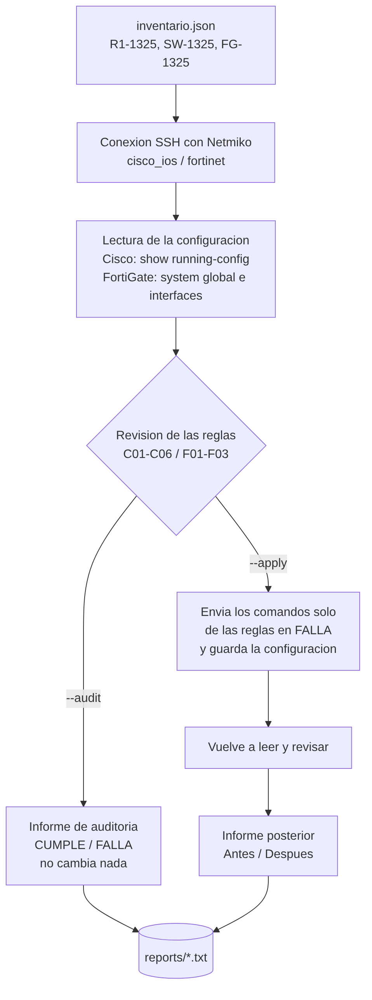

1. Lee la lista de equipos de `inventario.json`: nombre, tipo (`cisco_ios` o `fortinet`), IP y credenciales.
2. Entra a cada equipo por SSH con Netmiko.
3. Lee la configuración. En Cisco usa `show running-config`; en el FortiGate, `show full-configuration system global` y `show system interface`.
4. Revisa cada regla. Cada una tiene una función que comprueba si se cumple (CUMPLE o FALLA, con la evidencia) y otra que genera los comandos para corregirla.
5. Muestra el informe en pantalla y lo guarda en `reports/` como `.txt`.

| Regla | Qué comprueba | Qué aplica si falla |
|---|---|---|
| C01 | Que todas las `line vty` tengan `transport input ssh` | `transport input ssh` en cada bloque VTY |
| C02 | Que `exec-timeout` no sea 0 ni mayor de 10 minutos en con y vty (sin la línea, el IOS usa 10) | `exec-timeout 5 0` en con y vty |
| C03 | Que exista `banner motd` | `banner motd #ACCESO RESTRINGIDO...#` |
| C04 | Que exista `service password-encryption` | `service password-encryption` |
| C05 | Que no estén `ip http server` ni `ip http secure-server` | `no ip http server` y `no ip http secure-server` |
| C06 | Que exista `ip ssh version 2` | `ip ssh version 2` |
| F01 | Que ninguna interfaz tenga `http` o `telnet` en `allowaccess` | Deja en `allowaccess` todo menos `http` y `telnet` |
| F02 | Que `admintimeout` sea 5 o menos | `set admintimeout 5` |
| F03 | Que `pre-login-banner` esté en `enable` | `set pre-login-banner enable` |

### 8.2 Modos

| Modo | Comando | Qué hace |
|---|---|---|
| Informe sin aplicar | `python3 cis_hardening.py --audit` | Revisa las reglas y guarda el informe. No cambia nada |
| Aplicar e informe posterior | `python3 cis_hardening.py --apply` | Aplica solo las reglas que fallan, guarda la configuración en los Cisco (`write memory`), vuelve a revisar y guarda un informe con el estado antes y después |

### 8.3 Informe sin aplicar cambios

Antes del hardening manual corrí el script en modo `--audit`:

```
cd ~/cis-1325 && source venv/bin/activate
python3 cis_hardening.py --audit
```

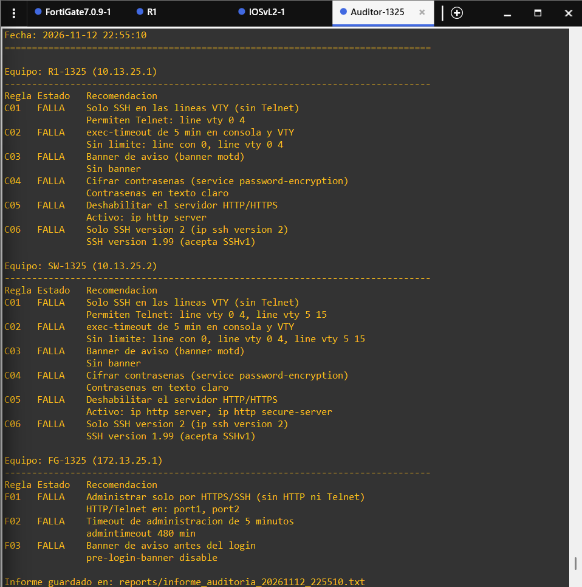

Las 9 reglas salen en **FALLA** en los tres equipos, con la evidencia de cada una (por ejemplo, qué líneas VTY permiten Telnet). Informe: [`informe_auditoria_20261112_225510.txt`](CIS-HARDENING/reportes/informe_auditoria_20261112_225510.txt).

---

## 9. Hardening manual

### 9.1 Router R1-1325

[`R1-1325_hardening.txt`](CIS-HARDENING/scripts/router/R1-1325_hardening.txt)

```
configure terminal
ip ssh version 2
line vty 0 4
 transport input ssh
 exec-timeout 5 0
line con 0
 exec-timeout 5 0
exit
banner motd #ACCESO RESTRINGIDO - Solo personal autorizado - Lab CIS 20251325#
service password-encryption
no ip http server
no ip http secure-server
end
write memory
```

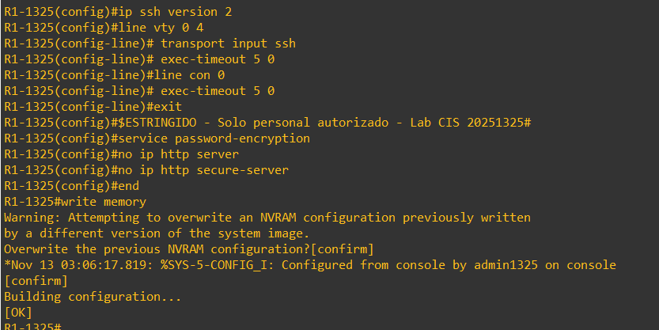

### 9.2 FortiGate FG-1325

[`FG-1325_hardening.txt`](CIS-HARDENING/scripts/fortigate/FG-1325_hardening.txt)

```
config system interface
    edit "port1"
        set allowaccess ping https ssh
    next
    edit "port2"
        set allowaccess ping https ssh
    next
end
config system global
    set admintimeout 5
    set pre-login-banner enable
end
```

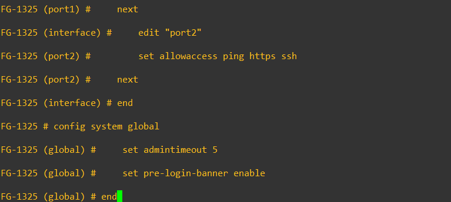

| Regla | Equivalente en la GUI |
|---|---|
| F01 | Network → Interfaces → port1 y port2 → desmarcar HTTP y TELNET |
| F02 | System → Settings → Idle timeout: 5 |
| F03 | System → Settings → Pre Login Banner |

---

## 10. Pruebas de las recomendaciones

Todos los comandos están en [`pruebas.txt`](CIS-HARDENING/scripts/pruebas.txt). Salvo que se indique, las pruebas se hacen desde AUDITOR-1325.

### C01: Telnet rechazado

```
telnet 10.13.25.1
```

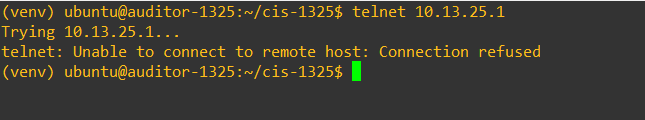

El router rechaza la conexión por el puerto 23: las VTY solo aceptan SSH.

### C03: Banner al entrar por SSH

```
ssh admin1325@10.13.25.1
```

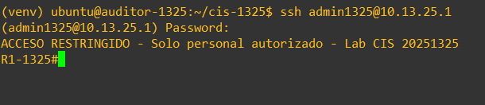

Al entrar aparece el aviso `ACCESO RESTRINGIDO - Solo personal autorizado - Lab CIS 20251325`.

### C02 y C04: Timeout y contraseña cifrada

En R1-1325:

```
show running-config | section line
```

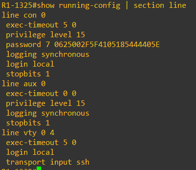

- **C02:** `line con 0` y `line vty 0 4` tienen `exec-timeout 5 0`. Si la sesión queda 5 minutos sin uso, se cierra sola.
- **C04:** la contraseña de la consola aparece como `password 7 0625002F...`. Antes se veía `Consola1325` en texto claro.

### C05: Sin servidor web en el router

```
curl http://10.13.25.1
curl -k https://10.13.25.1
```

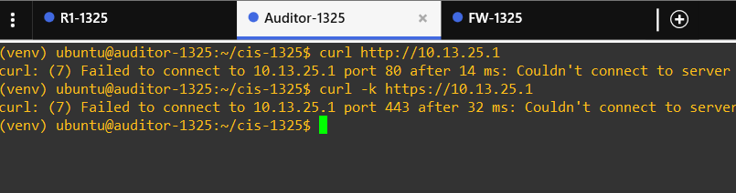

No hay nada escuchando en los puertos 80 ni 443.

### C06: Solo SSH versión 2

En R1-1325:

```
show ip ssh
```

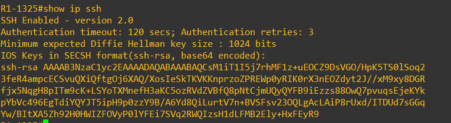

Aparece `SSH Enabled - version 2.0`. Antes del hardening decía `version 1.99`.

### F01: El FortiGate solo se administra por HTTPS y SSH

```
nc -zv 172.13.25.1 443
nc -zv -w 5 172.13.25.1 80
nc -zv -w 5 172.13.25.1 23
```

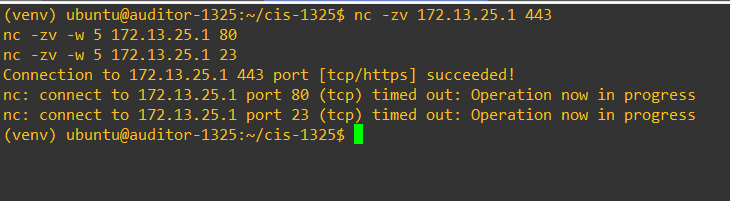

| Puerto | Servicio | Resultado |
|---|---|---|
| 443 | HTTPS | `succeeded`: sigue permitido |
| 80 | HTTP | `timed out`: bloqueado |
| 23 | Telnet | `timed out`: bloqueado |

### F02: Timeout de administración de 5 minutos

En FG-1325:

```
show full-configuration system global | grep admintimeout
```

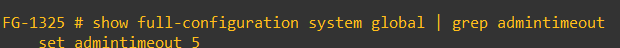

### F03: Banner antes del login del FortiGate

```
ssh admin@172.13.25.1
```

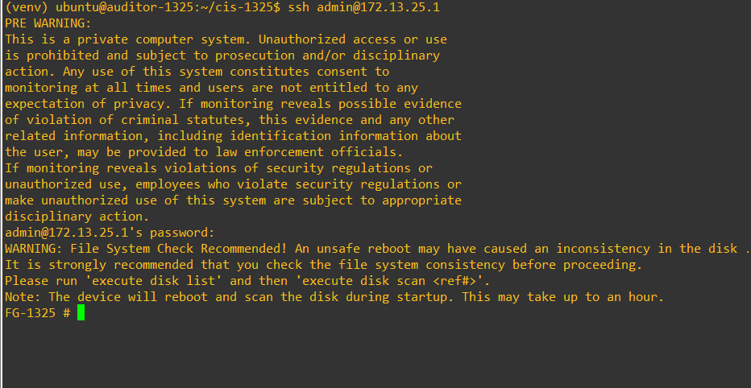

El aviso `PRE WARNING` aparece **antes** de que el FortiGate pida la contraseña.

### Resumen de pruebas

| Regla | Prueba | Resultado |
|---|---|---|
| C01 | `telnet 10.13.25.1` | Connection refused |
| C02 | `show running-config \| section line` | `exec-timeout 5 0` en con y vty |
| C03 | `ssh admin1325@10.13.25.1` | Aparece el banner |
| C04 | `show running-config \| section line` | `password 7` |
| C05 | `curl` a los puertos 80 y 443 del router | Failed to connect |
| C06 | `show ip ssh` | version 2.0 |
| F01 | `nc` a los puertos 443, 80 y 23 del FortiGate | Solo responde el 443 |
| F02 | `show full-configuration system global` | `set admintimeout 5` |
| F03 | `ssh admin@172.13.25.1` | Banner antes de la contraseña |

---

## 11. Script en modo aplicar y análisis posterior

### 11.1 Script en modo aplicar

```
python3 cis_hardening.py --apply
```

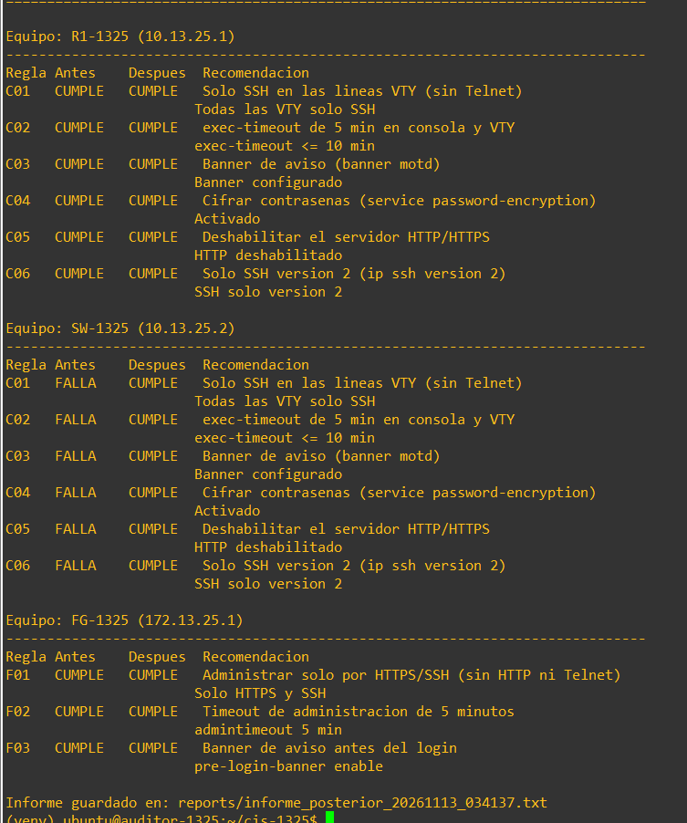

Informe: [`informe_posterior_20261113_034137.txt`](CIS-HARDENING/reportes/informe_posterior_20261113_034137.txt)

| Equipo | Antes | Después | Qué hizo el script |
|---|---|---|---|
| R1-1325 | 6 CUMPLE | 6 CUMPLE | Nada: ya estaba endurecido a mano |
| SW-1325 | 6 FALLA | 6 CUMPLE | Aplicó las 6 reglas de Cisco y guardó la configuración |
| FG-1325 | 3 CUMPLE | 3 CUMPLE | Nada: ya estaba endurecido a mano |

El script solo envía comandos a las reglas que fallan, así que no toca lo que ya está bien. En el running-config del switch se ven los cambios que hizo: `transport input ssh` y `exec-timeout 5 0` en `vty 0 4` y `vty 5 15`, `banner motd`, `service password-encryption`, `no ip http server`, `no ip http secure-server` e `ip ssh version 2`.

### 11.2 Análisis CIS después del hardening

**R1-1325:** de 13 a **16** controles que cumplen.

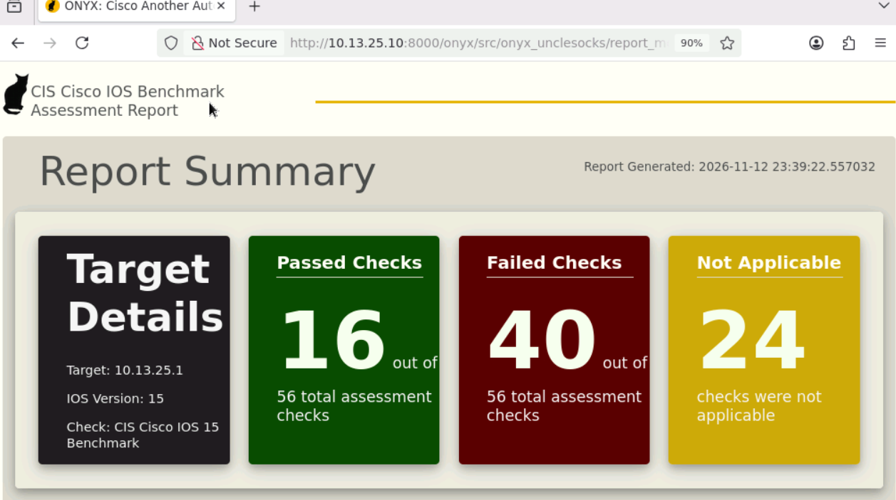

**SW-1325:** de 15 a **19** controles que cumplen.

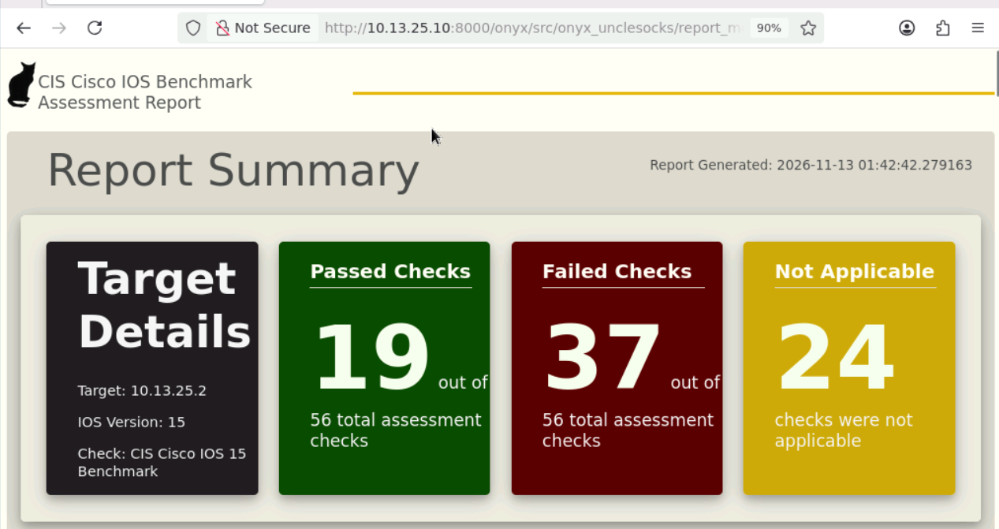

**FG-1325:** de 13 a **14** controles que cumplen.

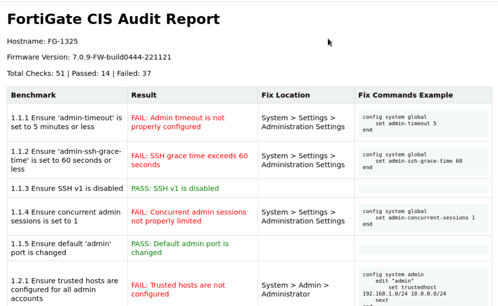

### 11.3 Comparación

| Equipo | Herramienta | Cumplen antes | Cumplen después | Reglas del script |
|---|---|---|---|---|
| R1-1325 | ONYX | 13 de 56 | 16 de 56 | 6 de 6 CUMPLE |
| SW-1325 | ONYX | 15 de 56 | 19 de 56 | 6 de 6 CUMPLE |
| FG-1325 | FortiGate CIS Checker | 13 de 51 | 14 de 51 | 3 de 3 CUMPLE |

**Por qué las herramientas suben menos que el número de reglas aplicadas:** las herramientas cuentan *controles del benchmark*, no mis reglas, y un control no siempre equivale a una regla:

- **exec-timeout:** el CIS lo revisa por separado en consola, VTY y AUX. En R1-1325 la línea `line aux 0` sigue con `exec-timeout 0 0`, así que ese control sigue fallando. En SW-1325 la línea AUX no tiene ese valor y usa el de fábrica (10 minutos).
- **Banners:** el CIS tiene un control para `banner exec`, otro para `banner login` y otro para `banner motd`. En R1-1325 solo configuré el motd. El IOSvL2 del switch ya trae de fábrica los banners exec y login, así que al agregar el motd cumple los tres. Por eso el switch sube más que el router.
- **FortiGate CIS Checker:** busca textos dentro del archivo de configuración. Reconoce el banner (F03), y por eso sube de 13 a 14. El control 1.1.1 busca `admin-timeout`, pero el comando de FortiOS es `admintimeout`, así que siempre marca FAIL aunque el valor sea 5. Tampoco distingue `http` de `https` en `allowaccess`, así que no reconoce que solo quedó HTTPS.

Las pruebas de la [sección 10](#10-pruebas-de-las-recomendaciones) y el informe posterior del script confirman que las 9 reglas se cumplen en los equipos.

---

## 12. Running-configs, scripts e informes

### Running-configs

| Archivo | Equipo |
|---|---|
| [`R1-1325_running-config.txt`](CIS-HARDENING/running-configs/R1-1325_running-config.txt) | Router R1-1325 (`show running-config`) |
| [`SW-1325_running-config.txt`](CIS-HARDENING/running-configs/SW-1325_running-config.txt) | Switch SW-1325 (`show running-config`) |
| [`FG-1325_running-config.txt`](CIS-HARDENING/running-configs/FG-1325_running-config.txt) | FortiGate FG-1325: system global, interfaces, ruta estática y política |
| [`netplan_auditor-1325.yaml`](CIS-HARDENING/running-configs/netplan_auditor-1325.yaml) | Configuración de red del Ubuntu auditor |

### Scripts

| Archivo | Descripción |
|---|---|
| [`auditor/cis_hardening.py`](CIS-HARDENING/scripts/auditor/cis_hardening.py) | Script de auditoría y hardening (`--audit` / `--apply`) |
| [`auditor/inventario.json`](CIS-HARDENING/scripts/auditor/inventario.json) | Equipos que revisa el script |
| [`auditor/01_instalar_herramientas.sh`](CIS-HARDENING/scripts/auditor/01_instalar_herramientas.sh) | Instalación de Python, Netmiko, ONYX y FortiGate CIS Checker |
| [`auditor/02_red_laboratorio.sh`](CIS-HARDENING/scripts/auditor/02_red_laboratorio.sh) | IP fija del Ubuntu y algoritmos SSH para el IOS 15 |
| [`auditor/03_exportar_config_fortigate.py`](CIS-HARDENING/scripts/auditor/03_exportar_config_fortigate.py) | Descarga la configuración del FortiGate para el checker |
| [`auditor/04_analisis_cis.sh`](CIS-HARDENING/scripts/auditor/04_analisis_cis.sh) | Comandos del análisis CIS con ONYX y el checker |
| [`router/R1-1325_base.txt`](CIS-HARDENING/scripts/router/R1-1325_base.txt) | Configuración base del router |
| [`router/R1-1325_hardening.txt`](CIS-HARDENING/scripts/router/R1-1325_hardening.txt) | Hardening manual del router |
| [`switch/SW-1325_base.txt`](CIS-HARDENING/scripts/switch/SW-1325_base.txt) | Configuración base del switch |
| [`fortigate/FG-1325_consola_inicial.txt`](CIS-HARDENING/scripts/fortigate/FG-1325_consola_inicial.txt) | IP de port2 por consola |
| [`fortigate/FG-1325_base_gui.md`](CIS-HARDENING/scripts/fortigate/FG-1325_base_gui.md) | Configuración base del FortiGate por GUI |
| [`fortigate/FG-1325_hardening.txt`](CIS-HARDENING/scripts/fortigate/FG-1325_hardening.txt) | Hardening manual del FortiGate |
| [`webterm/network-config.txt`](CIS-HARDENING/scripts/webterm/network-config.txt) | Configuración de red del webterm |
| [`pruebas.txt`](CIS-HARDENING/scripts/pruebas.txt) | Comandos de las pruebas |

### Informes del script

| Archivo | Descripción |
|---|---|
| [`informe_auditoria_20261112_225510.txt`](CIS-HARDENING/reportes/informe_auditoria_20261112_225510.txt) | Modo `--audit`: las 9 reglas en FALLA |
| [`informe_posterior_20261113_034137.txt`](CIS-HARDENING/reportes/informe_posterior_20261113_034137.txt) | Modo `--apply`: estado antes y después |
